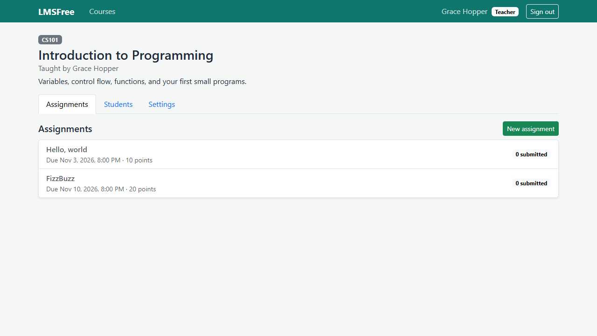
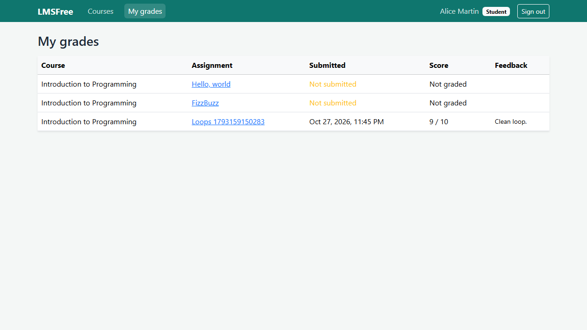

# LMSFree

A small learning management system for a school or a bootcamp. Teachers run courses and grade work, students hand in assignments and see their grades, admins manage accounts.

License: Apache-2.0. Keep `LICENSE` and `NOTICE` if you fork it.
Author: Daniel Llano ([github.com/daniel-llano](https://github.com/daniel-llano))





## What it does

- Students register themselves. Teachers enroll them in a course by email.
- Teachers create assignments with a due date and a point scale.
- Students submit text, a file, or both, and can resubmit until the work is graded. Late work is flagged.
- Teachers download submissions, give a score and feedback, and students see it on their grades page.
- Admins create teacher and admin accounts, change roles, and deactivate users.
- Password reset goes through email with a single-use link that expires in an hour.

Access is checked per course. Students only see courses they're enrolled in and only their own work. Teachers only manage their own courses.

## Layout

```
lmsfree/
├── src/LMSFree.Domain           entities
├── src/LMSFree.Infrastructure   EF Core (PostgreSQL), JWT, email, file storage
├── src/LMSFree.Api              minimal API endpoints, authorization, seeding
├── tests/LMSFree.Api.Tests      integration tests
├── web/                         React + TypeScript (Vite), served by nginx
├── infra/                       docker-compose: PostgreSQL, API, web, Mailpit
└── e2e/                         Playwright tests against the compose stack
```

## Run it

```bash
./scripts/run.sh        # or .\scripts\run.ps1
```

| What | Where |
|------|-------|
| Web app | http://localhost:5174 |
| API reference | http://localhost:5270/docs |
| Mailpit (outgoing email) | http://localhost:8025 |

Compose seeds a sample course. Sign in with any of these:

| Account | Password |
|---------|----------|
| `admin@lmsfree.local` | `Admin@1234` |
| `teacher@lmsfree.local` | `Teacher@1234` |
| `alice@lmsfree.local`, `bob@lmsfree.local` | `Student@1234` |

Without Docker for the apps, start just the database with `docker compose -f infra/docker-compose.yml up postgres`, then:

```bash
dotnet run --project src/LMSFree.Api     # http://localhost:5270, Development settings
cd web && npm install && npm run dev      # http://localhost:5174
```

## Configuration

| Key | Notes |
|-----|-------|
| `ConnectionStrings:Lms` | PostgreSQL |
| `Jwt:Secret` | Required, 32+ characters |
| `Database:MigrateOnStartup` | Off by default. Run `dotnet ef database update` from your pipeline in production |
| `Bootstrap:AdminEmail`, `Bootstrap:AdminPassword` | Creates the first admin |
| `App:PublicUrl` | Where the web app lives. Used for links in email |
| `Email:Smtp:*` | SMTP server. Without a host, mail is written to the log |
| `Storage:Path` | Folder for uploaded files. The container uses the `/data` volume |
| `Cors:Origins` | Only needed when the web app is on another origin |
| `SeedSampleData`, `EnableApiDocs` | Off by default |

Uploads are capped at 10 MB, limited to documents, images, archives, and source files, and always served as downloads.

## Tests

```bash
./scripts/test.sh   # API integration tests, web typecheck + Vitest + build
./scripts/e2e.sh    # Docker stack + Playwright
```

See [TESTING.md](TESTING.md).
